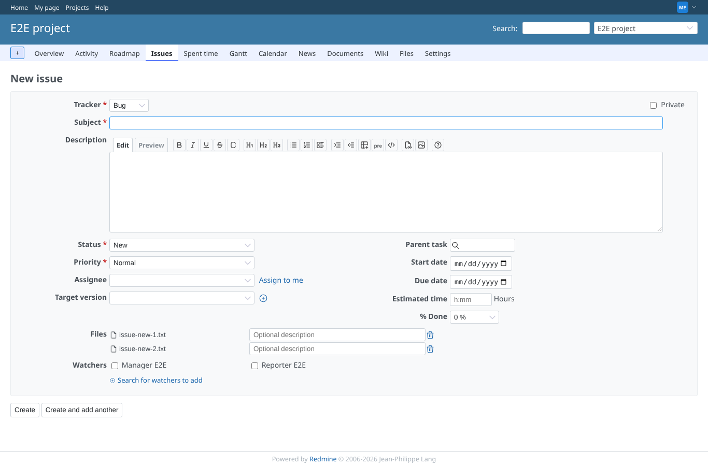
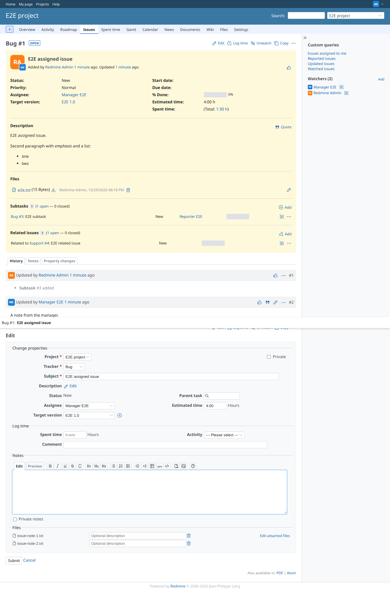
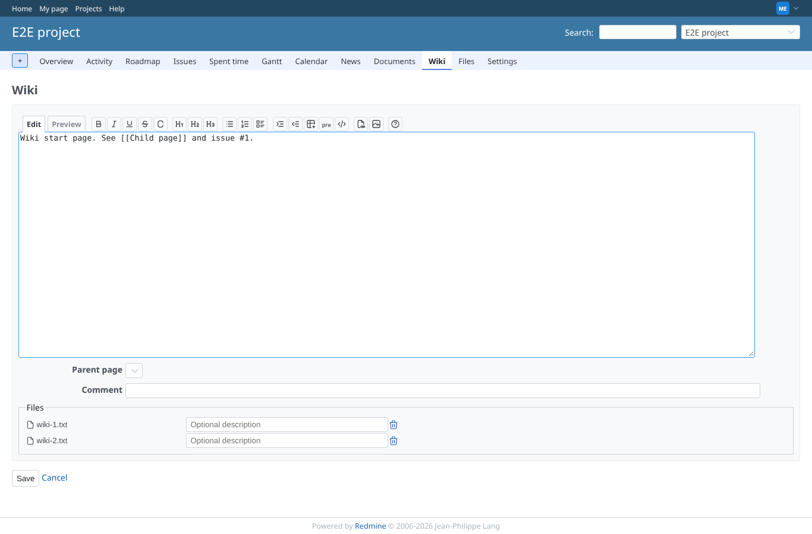
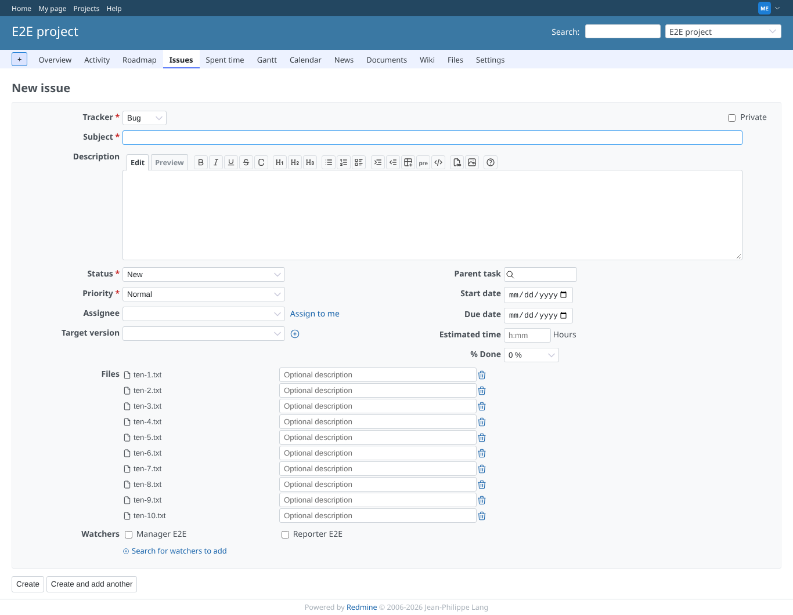
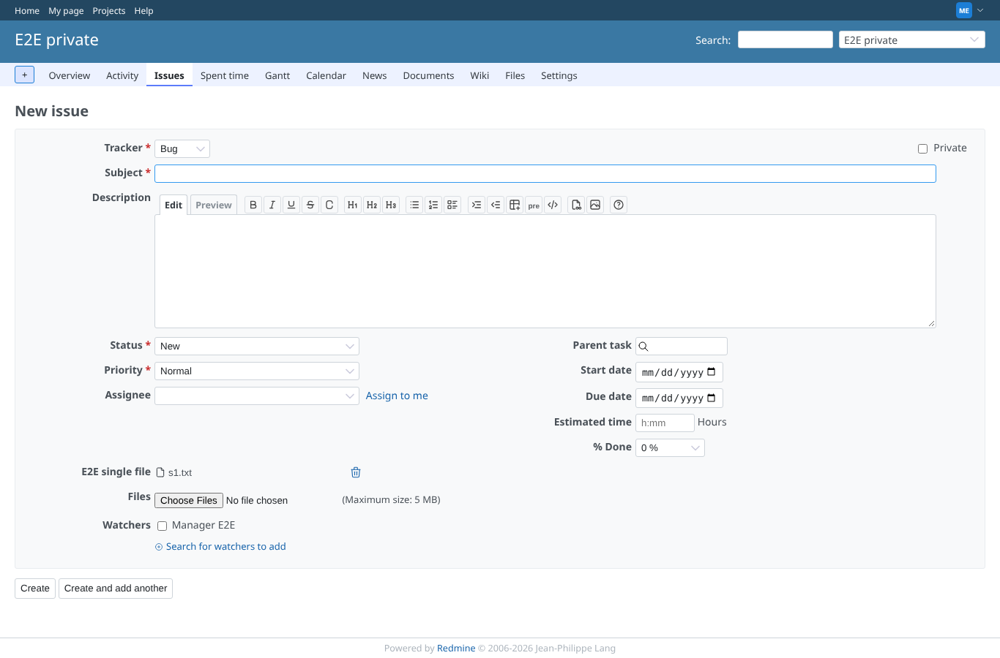

# limit-delivery

Run 2026-10-29T20:19:50.549Z against http://127.0.0.1:3000.

| screenshot | user | URL | shows |
|---|---|---|---|
|  | manager | `/projects/e2e-project/issues/new` | issue-new: limit 2, 3 files picked, the third refused with "This file cannot be uploaded because it exceeds the maximum number of files that can be attached simultaneously (2)", add button gone |
|  | manager | `/issues/1` | issue-note: limit 2, 3 files picked, the third refused with "This file cannot be uploaded because it exceeds the maximum number of files that can be attached simultaneously (2)", add button gone |
|  | manager | `/projects/e2e-project/wiki/Wiki/edit` | wiki: limit 2, 3 files picked, the third refused with "This file cannot be uploaded because it exceeds the maximum number of files that can be attached simultaneously (2)", add button gone |
|  | manager | `/projects/e2e-project/issues/new` | Limit unset: 11 files picked, 10 kept, alert "This file cannot be uploaded because it exceeds the maximum number of files that can be attached simultaneously (10)" |
|  | manager | `/projects/e2e-private/issues/new` | Single-file custom field: 2 files dropped, 1 kept, alert "This file cannot be uploaded because it exceeds the maximum number of files that can be attached simultaneously (1)" |
